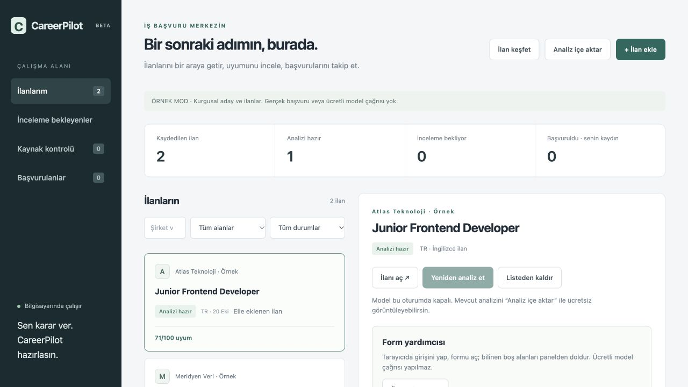

# CareerPilot

**A local-first job application hub — beta preview.**

[English](README.md) · [Türkçe](README.tr.md) · [User guide (Turkish)](docs/KULLANIM_KILAVUZU.md)

Discover job postings, compare their requirements with your documented experience,
prepare application materials and track your applications in one local dashboard.
CareerPilot combines AI-assisted preparation with supervised form assistance;
you review the result and submit the application yourself.



*Actual application screenshot in demo mode. All applicant and job data shown is
fictional. The current interface is in Turkish; job analysis supports Turkish
and English postings.*

## What the beta does

- **Job discovery:** runs existing FreeHire, quota-controlled SerpAPI search and
  configured Greenhouse/Lever feeds in one user-triggered flow. Supports software,
  data/business analysis, IT audit, finance/accounting and marketing role groups.
- **Source and quality checks:** separates incomplete, stale, experienced-level
  and unverified candidates from reviewable postings. Supported employer-feed
  checks establish current presence, not publication date or candidate fit.
- **Evidence-based analysis:** links job requirements to existing profile facts,
  distinguishes direct, partial and missing evidence, and computes a transparent
  0–100 coverage score. This is not a hiring probability or an external ATS score.
- **Application materials:** selects a local CV by language, photo policy and
  general/finance focus; previews factual cover-letter drafts for review.
- **Supervised form assistance:** opens supported forms and helps fill known
  visible fields after destination-specific sharing approval.
- **Application tracking:** stores user-reported application stages, dates and
  notes, with recoverable removal and duplicate-review groups.

## Try it without API keys

Requires **Node.js 22+** and npm. From the cloned repository:

```sh
npm ci
npm run browser:install
npm run hub -- --demo
```

Open **http://127.0.0.1:3210/**. Demo mode uses fictional records and a local mock
form. It does not call a cloud model or search provider. Demo CV paths are
placeholders; no real CV is bundled. Keep the terminal open; use `Ctrl+C` to stop.

## Use your own profile

Personal setup requires a private `.careerpilot/profile.json`, local CV files
and, for AI analysis/search, your own provider configuration. See the
[setup reference](docs/USAGE.md#local-hub-dashboard) and
[daily-use guide](docs/KULLANIM_KILAVUZU.md).

Copy `.env.example` to `.env` only if `.env` does not already exist. Enter your
own API credentials, explicit model and verified pricing. Paid calls are disabled
in the example; enabling them still requires separate approval for each analysis.
Never commit the completed configuration or your personal profile.

Once configured:

```sh
npm start
```

Open **http://127.0.0.1:3211/**. This enables the search and analysis features;
startup itself does not run a search or a paid analysis. To view the same local
records without model/search connections, use `npm run start:offline`.
The app is a local process, not an automatically started background service.

## Privacy and cost controls

Profiles, application history and accounting records stay in the ignored
`.careerpilot/` directory; CVs remain at their private local paths. AI analysis
sends the job text and professional profile facts after explicit consent.
Contact fields and CV files are excluded from the analysis request. Search
providers receive search criteria, not the private applicant profile.

A persistent ledger enforces configured monthly and per-run model budgets.
Uncertain billing retains its reservation, and automatic network retries are
disabled. Each analysis shows its destination and spending limits before consent.
Search has its own quota, cache and cooldown controls. These controls do not
replace reviewing the provider's billing or the actual application form.

## Limits to understand

This is a beta for individual local use. It is not a hosted multi-user service
or an unattended application bot. Discovery covers configured sources and bounded
result pages, not every company or job site. Aggregator totals and recent search
indexing do not prove that an opening is current or suitable.

Login, CAPTCHA, uncertain answers, legal consent, file uploads in the shared
assistant and final submission remain human-controlled. Recognising a LinkedIn,
Indeed or Kariyer.net URL does not mean its complete application flow works.
Workday and LinkedIn Easy Apply do not have verified end-to-end native support;
Greenhouse filling/upload is not implemented. The separate Lever draft workflow
has its own explicit approvals. Browser actions performed through a chat are
not proof of native product compatibility.

## Engineering and validation

TypeScript, Node.js, Playwright, Zod and a lightweight HTML/CSS/JavaScript dashboard.
The model selects factual references; local code validates them, scores evidence
and enforces privacy, consent and budget boundaries. See the approved
[architecture](docs/HYBRID_ARCHITECTURE.md) and [current status](docs/PROJECT_STATUS.md).

```sh
npm run check
```

The current baseline is **170 passing offline tests** (20 October 2026), including
mocked provider failures, persistent budgets, source filtering, partial search
results, consent gates, document selection and authored browser forms. These
tests do not establish compatibility with every live hiring site. A separately
approved live-model preparation flow has also been exercised; it is not a
production reliability benchmark.

This is a personal, AI-assisted software development project. Beta capabilities,
validation and remaining gaps are documented separately rather than presented as
fully autonomous job seeking.

## Documentation and project status

- [Turkish overview](README.tr.md)
- [Daily user guide (Turkish)](docs/KULLANIM_KILAVUZU.md)
- [Technical usage reference](docs/USAGE.md)
- [Current work and known gaps](docs/PROJECT_STATUS.md)
- [Development instructions](AGENTS.md)

## Portfolio and reuse

CareerPilot is presented as a portfolio beta. No open-source licence is granted
for the project; the package is marked `UNLICENSED`. Third-party dependencies
retain their own licences. See [publication notes](docs/PUBLICATION.md) for the
release scope and [security notes](SECURITY.md) before sharing diagnostics.
